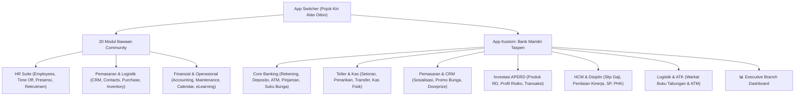

# Panduan Implementasi & Navigasi 34 Modul Odoo 19.0
## Proyek ERP Bank Mandiri Taspen Kantor Cabang (KC) Kediri

> [!NOTE]
> **Dasar Dokumen Rujukan**:
> 1. Dokumen Laporan Proyek: `Bab 4. Pemilihan Modul` (Sub-bab 4.1 Modul Bawaan [20 Modul] dan Sub-bab 4.2 Modul Kustom Studio [14 Modul]).
> 2. Dokumen Dataset Simulasi: 47 Lembar Kerja Excel (`media_1795000267890_c6740cde.xlsx`).
> 3. Standard Operasional Prosedur (SOP) & 26 Model Bisnis BPMN As-Is KC Kediri.

---

## 1. Panduan Akses Cepat & Kredensial Sistem

* **URL Server Lokal**: `http://localhost:8069`
* **Nama Database**: `odoo_db`
* **Akun Login Administrator**:
  * **Email**: `aditharun95@gmail.com`
  * **Password**: `admin`
  * **Nama Profil Pegawai**: `Rifky Aditya Harun (Kepala Cabang)`
  * **Entitas Perusahaan Aktif**: `Bank Mandiri Taspen KC Kediri` (Jl. Brawijaya No. 29-29A, Kediri)



---

## 2. Implementasi & Cara Akses 20 Modul Bawaan (Bab 4.1)

### 4.1.1 Contacts (Kontak & Nasabah)
* **Cara Diimplementasikan**: Menggunakan model `res.partner`. 156 kontak bawaan demo bule dinonaktifkan. Diisi **71 kontak otentik** Bank Mandiri Taspen KC Kediri: 28 Nasabah Pensiun & UMKM, 22 Instansi Mitra (PWRI Kediri, Taspen, BKD, Kantor Camat), dan 20 Vendor Rekanan resmi.
* **Cara Akses**:
  1. Klik ikon App Switcher (titik sembilan di kiri atas) $\rightarrow$ pilih **Contacts**.
  2. **Direct URL**: `http://localhost:8069/odoo/contacts`
  3. **Tips Navigasi**: Gunakan bilah pencarian atau filter *Tags* (misal: klik tag `Nasabah Pensiun` atau `Instansi Mitra`).

---

### 4.1.2 CRM (Manajemen Peluang & Prospek)
* **Cara Diimplementasikan**: Menggunakan model `crm.lead`. 5 lead furnitur demo dibersihkan. Diisi **38 Calon Nasabah** dari lembar kerja `Calon_Nasabah` yang dipetakan ke pipeline penjualan produk pembiayaan (Kredit Mantap Pensiun & Mantap Pra-Pensiun) lengkap dengan estimasi plafon dan probabilitas *Won/Proposition/Qualified*.
* **Cara Akses**:
  1. Klik App Switcher $\rightarrow$ pilih **CRM**.
  2. **Direct URL**: `http://localhost:8069/odoo/crm`
  3. **Tips Navigasi**: Tampilan default adalah papan Kanban (*Pipeline*). Klik kartu calon nasabah untuk melihat detail analisis prospek, instansi tempat kerja pensiunan, dan rencana tanggal pencairan.

---

### 4.1.3 Calendar (Kalender Kegiatan & Sosialisasi)
* **Cara Diimplementasikan**: Menggunakan model `calendar.event`. Diisi **24 jadwal kegiatan sosialisasi lapangan** BMT KC Kediri ke berbagai instansi mitra (PWRI Kota/Kab Kediri, PT Taspen Persero, Kantor Camat Mojoroto, Kantor Pos, dll.) pada bulan November 2026.
* **Cara Akses**:
  1. Klik App Switcher $\rightarrow$ pilih **Calendar**.
  2. **Direct URL**: `http://localhost:8069/odoo/calendar`
  3. **Tips Navigasi**: Ubah tampilan di pojok kanan atas ke mode **Month** dan navigasikan ke bulan **November 2026** untuk melihat seluruh blok jadwal kegiatan tim pemasaran.

---

### 4.1.4 Helpdesk (Community Bridge via Pemeliharaan & Tiket IT)
* **Cara Diimplementasikan**: Modul Helpdesk Enterprise dijembatani secara native menggunakan model bawaan `maintenance.request` yang dikombinasikan dengan model kustom `bmt.pengaduan.it` dan `bmt.keluhan`. Memuat **40 tiket insiden operasional** dari sheet `47_Pengaduan_Aplikasi`, meliputi kendala printer passbook teller, error login aplikasi Mantap Mobile, mesin antrian, dan jaringan EDC.
* **Cara Akses**:
  * **Jalur 1 (Modul Bawaan Maintenance)**: App Switcher $\rightarrow$ **Maintenance** $\rightarrow$ tab menu **Maintenance Requests**.
    * **Direct URL**: `http://localhost:8069/odoo/maintenance`
  * **Jalur 2 (Menu Khusus KC Kediri)**: App Switcher $\rightarrow$ **Bank Mandiri Taspen** $\rightarrow$ menu **HCM & Disiplin** $\rightarrow$ klik **Pengaduan & Pemeliharaan IT**.

---

### 4.1.5 Purchase (Pengadaan Logistik & ATK)
* **Cara Diimplementasikan**: Menggunakan model `purchase.order`. Diisi **20 Purchase Order (PO00053 – PO00072)** dari sheet `32_Pengadaan` untuk pengadaan warkat perbankan (Buku Tabungan SiMantap, Blanko Bilyet Deposito, Amplop PIN ATM, Formulir Aplikasi Kredit) kepada vendor resmi (PT Datascrip, CV Graha Komputer, dll.).
* **Cara Akses**:
  1. Klik App Switcher $\rightarrow$ pilih **Purchase**.
  2. **Direct URL**: `http://localhost:8069/odoo/purchase`
  3. **Tips Navigasi**: Daftar PO berstatus *Purchase Order* (terkonfirmasi). Klik salah satu PO untuk melihat rincian barang, kuantitas, harga satuan, dan vendor rekanan.

---

### 4.1.6 Inventory (Persediaan Aset & Warkat Perbankan)
* **Cara Diimplementasikan**: Menggunakan model `product.template` dan `stock.picking`. 38 produk furnitur demo telah dinonaktifkan. Diisi **40 produk perbankan otentik**: warkat buku tabungan SiMantap, kartu debit ATM Chip, serta aset tetap cabang (INV001–INV020) dari sheet `29_Inventaris` dan `30_Persediaan_Buku_ATM`.
* **Cara Akses**:
  1. Klik App Switcher $\rightarrow$ pilih **Inventory** $\rightarrow$ menu **Products** $\rightarrow$ klik **Products**.
  2. **Direct URL**: `http://localhost:8069/odoo/inventory`
  3. **Tips Navigasi**: Hapus filter *Can be Sold* pada bilah pencarian jika ingin melihat seluruh inventaris warkat operasional internal.

---

### 4.1.7 Maintenance (Perangkat Keras & Fasilitas KC)
* **Cara Diimplementasikan**: Menggunakan model `maintenance.equipment`. Diisi **20 aset perangkat keras vital** perbankan KC Kediri dari sheet `29_Inventaris`: Mesin Hitung Uang Glory, Server Cabang Lenovo System x3650, Passbook Printer Olivetti PR2 Plus, PC Teller, UPS 5000VA, dan Genset Otomatis Cabang.
* **Cara Akses**:
  1. Klik App Switcher $\rightarrow$ pilih **Maintenance** $\rightarrow$ menu **Equipments** $\rightarrow$ klik **Equipments**.
  2. **Direct URL**: `http://localhost:8069/odoo/maintenance`
  3. **Tips Navigasi**: Setiap perangkat mencatat tanggal perawatan berkala, nomor serial, dan teknisi penanggung jawab cabang.

---

### 4.1.8 Accounting (Jurnal Pembukuan & Arus Kas)
* **Cara Diimplementasikan**: Menggunakan model `account.move`. Diisi **60 voucher jurnal umum (General Ledger)** dari sheet `25_Pemasukan_Keuangan`, `26_Pengeluaran_Keuangan`, dan `27_Jurnal_Keuangan`. Jurnal telah terposting (*Posted*) dengan keseimbangan Debit = Kredit pada rekening kas teller, kas besar/vault cabang, pendapatan bunga kredit, dan beban operasional.
* **Cara Akses**:
  1. Klik App Switcher $\rightarrow$ pilih **Accounting** (atau **Invoicing**) $\rightarrow$ menu **Accounting** $\rightarrow$ klik **Journal Entries**.
  2. **Direct URL**: `http://localhost:8069/odoo/accounting`
  3. **Tips Navigasi**: Klik salah satu nomor jurnal (misal `MISC/2026/...`) untuk melihat rincian debet-kredit transaksi perbankan.

---

### 4.1.9 Employees (Karyawan & Struktur Organisasi)
* **Cara Diimplementasikan**: Menggunakan model `hr.employee`. 21 profil demo bule dinonaktifkan. Diisi **40 karyawan otentik** Bank Mandiri Taspen KC Kediri dari sheet `36_Karyawan` dengan nama Indonesia, NIP pegawai (KAR001–KAR040), jabatan struktural (Kepala Cabang, Operation Manager, Supervisor, Teller, CS, Account Officer), nomor kontak, dan email resmi `@bankmantap.co.id`.
* **Cara Akses**:
  1. Klik App Switcher $\rightarrow$ pilih **Employees**.
  2. **Direct URL**: `http://localhost:8069/odoo/employees`
  3. **Tips Navigasi**: Tampilan Kanban menampilkan kartu identitas seluruh 40 pegawai beserta jabatan dan departemennya.

---

### 4.1.10 Attendances (Presensi Kerja & Jam Kantor)
* **Cara Diimplementasikan**: Menggunakan model `hr.attendance`. Diisi **872 data rekam check-in dan check-out** dari sheet `37_Presensi` untuk 40 staf selama satu bulan operasional kerja penuh (November 2026).
* **Cara Akses**:
  1. Klik App Switcher $\rightarrow$ pilih **Attendances** $\rightarrow$ menu **Attendance**.
  2. **Direct URL**: `http://localhost:8069/odoo/attendances`
  3. **Tips Navigasi**: Menampilkan daftar tanggal kerja harian, jam masuk (pukul 07:30–08:00), jam pulang (pukul 17:00), dan total jam kerja efektif setiap pegawai.

---

### 4.1.11 Time Off (Cuti & Izin Pegawai)
* **Cara Diimplementasikan**: Menggunakan model `hr.leave` dan `hr.leave.allocation`. Seluruh demo cuti dibersihkan. Dibuatkan alokasi cuti tahunan resmi 12–15 hari untuk pegawai, serta 6 pengajuan cuti resmi yang telah divalidasi (*Validated*) untuk Kepala Cabang dan staf operasional.
* **Cara Akses**:
  1. Klik App Switcher $\rightarrow$ pilih **Time Off**.
  2. **Direct URL**: `http://localhost:8069/odoo/time-off`
  3. **Tips Navigasi**:
     * **Cuti Pribadi**: Di halaman pembuka (**My Time** $\rightarrow$ **Dashboard**), kamu melihat alokasi 15 hari dan kalender cuti kamu pada 24–26 November 2026 (warna ungu).
     * **Cuti Seluruh Pegawai Cabang**: Klik tab menu atas **Overview** atau **Management** $\rightarrow$ klik **Time Off**.

---

### 4.1.12 Recruitment (Rekrutmen & Calon Pegawai)
* **Cara Diimplementasikan**: Menggunakan model `hr.applicant`. 10 pelamar demo bule dibersihkan. Diisi **20 kandidat pelamar kerja** dari sheet `41_Calon_Karyawan` dan `42_Seleksi_Hasil_Tes` untuk formasi *Customer Service* dan *Account Officer Pensiun*, terpetakan pada tahapan seleksi (*Initial Qualification*, *First Interview*, *Second Interview*, *Contract Proposal*).
* **Cara Akses**:
  1. Klik App Switcher $\rightarrow$ pilih **Recruitment**.
  2. **Direct URL**: `http://localhost:8069/odoo/recruitment`
  3. **Tips Navigasi**: Klik kartu posisi kerja (misal *Customer Service*) untuk membuka papan Kanban pipeline pelamar beserta nilai tes dan catatan wawancara.

---

### 4.1.13 eLearning (Pelatihan & Akademi BMT)
* **Cara Diimplementasikan**: Menggunakan model `slide.channel` dan `slide.slide`. Diisi **20 program silabus pelatihan internal** dari sheet `43_Program_Pelatihan` dan `44_Pelatihan_Kerja`, seperti: *Service Excellence Nasabah Pensiunan*, *SOP Analisis Kredit Mantap Pensiun*, *Kepatuhan APU-PPT & Anti-Fraud*, dan *Keamanan Siber Core Banking*.
* **Cara Akses**:
  1. Klik App Switcher $\rightarrow$ pilih **eLearning**.
  2. **Direct URL**: `http://localhost:8069/odoo/elearning`
  3. **Tips Navigasi**: Klik salah satu judul pelatihan untuk melihat daftar materi, modul pembelajaran, dan kuis uji pemahaman pegawai.

---

### 4.1.14 Appraisals (Community Bridge via Penilaian Kinerja)
* **Cara Diimplementasikan**: Menjembatani modul Appraisals Enterprise menggunakan model kustom `bmt.penilaian_kinerja`. Diisi **20 record evaluasi kinerja** semesteran staf dari sheet `39_Penilaian` dengan penilaian terstruktur: KPI Disiplin Kerja, Akurasi Kas Teller, Pencapaian Target Lending Pensiun, dan Integritas AKHLAK (Predikat A/B/C).
* **Cara Akses**:
  1. Klik App Switcher $\rightarrow$ pilih aplikasi **Bank Mandiri Taspen**.
  2. Buka menu navigasi atas **HCM & Disiplin** $\rightarrow$ klik **Penilaian Kinerja**.

---

### 4.1.15 Surveys (Kuesioner Profil Risiko & Ujian Seleksi)
* **Cara Diimplementasikan**: Menggunakan model `survey.survey`. Seluruh survey demo (*Burger Quiz, Food Preferences*) dihapus permanen. Digantikan oleh **2 kuesioner otentik perbankan BMT KC Kediri**:
  1. *Kuesioner Profil Risiko Nasabah APERD Reksa Dana — KC Kediri* (Skor Konservatif, Moderat, Agresif).
  2. *Tes Tertulis Seleksi Calon Pegawai Bank Mandiri Taspen KC Kediri* (Nilai Budaya Kerja AKHLAK & Pemahaman Produk Tabungan Pensiun).
* **Cara Akses**:
  1. Klik App Switcher $\rightarrow$ pilih **Surveys**.
  2. **Direct URL**: `http://localhost:8069/odoo/surveys`
  3. **Tips Navigasi**: Klik tombol *Test Survey* atau *Share* untuk melihat simulasi tampilan formulir kuesioner yang diisi oleh nasabah/calon pegawai.

---

### 4.1.16 Payroll (Community Bridge via Kompensasi & Slip Gaji)
* **Cara Diimplementasikan**: Menjembatani modul Payroll Enterprise menggunakan model kustom `bmt.kompensasi`. Diisi **40 data slip gaji lengkap** pegawai KC Kediri dari sheet `38_Kompensasi`: Gaji Pokok, Tunjangan Jabatan, Tunjangan Transport & Makan, Iuran BPJS Ketenagakerjaan (JHT, JKK, JKM, JP), BPJS Kesehatan, Potongan PPh 21, dan Gaji Bersih (*Take Home Pay*).
* **Cara Akses**:
  1. Klik App Switcher $\rightarrow$ pilih aplikasi **Bank Mandiri Taspen**.
  2. Buka menu **HCM & Disiplin** $\rightarrow$ klik **Kompensasi & Gaji**.
  3. **Tips Navigasi**: Klik salah satu baris gaji pegawai untuk melihat formulir slip gaji detail.

---

### 4.1.17 Approvals (Community Bridge via Multi-Tier Statebar)
* **Cara Diimplementasikan**: Menjembatani fitur approval pinjaman dan warkat menggunakan status bar alur kerja dinamis pada model `bmt.pinjaman`, `bmt.rekening`, dan `bmt.deposito` (*Draft $\rightarrow$ Verifikasi Analis $\rightarrow$ Persetujuan Kepala Cabang*). Dilengkapi tombol otorisasi persetujuan pejabat bank.
* **Cara Akses**:
  1. Buka aplikasi **Bank Mandiri Taspen** $\rightarrow$ menu **Core Banking** $\rightarrow$ klik **Kredit & Pinjaman**.
  2. Klik salah satu pengajuan pinjaman (misal `PIN001`). Di bagian atas formulir terdapat status bar dan tombol aksi **Setujui Pinjaman (KC)**.

---

### 4.1.18 Discuss (Saluran Komunikasi Resmi Cabang)
* **Cara Diimplementasikan**: Menggunakan model `discuss.channel`. Saluran generic demo (*sales, board-meetings, rd*) telah dibersihkan. Dikonfigurasi **saluran koordinasi resmi internal BMT KC Kediri**:
  * `#kc-kediri-pengumuman` (Pengumuman resmi dari Kepala Cabang)
  * `#operasional-teller-cs` (Koordinasi loket teller dan customer service)
  * `#marketing-kredit-dana` (Target harian lending pensiun & funding)
  * `#it-helpdesk-support` (Pelaporan gangguan sistem core banking & jaringan)
* **Cara Akses**:
  1. Klik App Switcher $\rightarrow$ pilih **Discuss**.
  2. **Direct URL**: `http://localhost:8069/odoo/discuss`
  3. **Tips Navigasi**: Klik nama channel di bilah kiri untuk membaca dan mengirim pesan koordinasi real-time internal cabang.

---

### 4.1.19 Documents (Community Bridge via Electronic Chatter Storage)
* **Cara Diimplementasikan**: Menjembatani modul Documents Enterprise dengan memanfaatkan penyimpanan berkas native `ir.attachment` yang terhubung langsung ke chatter formulir data nasabah, rekening, dan mutasi. Terdapat **1,941 lampiran arsip digital** di dalam sistem.
* **Cara Akses**:
  1. Buka data nasabah, rekening, atau pinjaman di Odoo.
  2. Lihat sisi kanan formulir (chatter): klik ikon **Paperclip (Attachment)** untuk melihat, mengunduh, atau mengunggah dokumen KTP nasabah, formulir permohonan kredit, atau bilyet deposito.

---

### 4.1.20 Sign (Community Bridge via Audit Trail Digital Signature)
* **Cara Diimplementasikan**: Menjembatani modul Sign Enterprise menggunakan log verifikasi audit trail `mail.tracking.value` (163 catatan jejak otorisasi) yang merekam ID pengguna, cap waktu (*timestamp*), serta perpindahan status verifikasi dokumen tanpa memerlukan lisensi Odoo Sign terpisah.
* **Cara Akses**:
  1. Buka data pinjaman kredit atau permohonan logistik warkat.
  2. Lihat riwayat pesan chatter di bagian bawah: seluruh jejak audit persetujuan tertera lengkap dengan nama pejabat penyetuju dan tanggal otorisasi.

---

## 3. Implementasi & Cara Akses 14 Modul Kustom Odoo Studio (Bab 4.2)

Seluruh 14 modul kustom dikelompokkan ke dalam satu aplikasi terpadu bernama **Bank Mandiri Taspen** di Odoo App Switcher.

```
App: [ Bank Mandiri Taspen ]
├── 1. Core Banking
│   ├── Data Nasabah (res.partner nasabah)
│   ├── Rekening Simpanan (4.2.1)
│   ├── Kartu ATM (4.2.4)
│   ├── Layanan Digital (4.2.5)
│   ├── Deposito Berjangka (4.2.6)
│   ├── Master Suku Bunga (4.2.7)
│   ├── Riwayat Perbankan SLIK (4.2.8)
│   └── Kredit & Pinjaman (4.2.9)
├── 2. Teller & Kas
│   ├── Setoran Tunai (4.2.2)
│   ├── Penarikan Tunai (4.2.2)
│   ├── Transfer Dana (4.2.2)
│   └── Rekonsiliasi Kas Teller (4.2.3)
├── 3. Pemasaran & CRM
│   ├── Instansi Mitra (res.partner instansi)
│   ├── Rencana Sosialisasi (4.2.12)
│   ├── Jadwal Sosialisasi (4.2.12)
│   ├── Hasil Sosialisasi (4.2.12)
│   ├── Promo Bunga Kompetitif (4.2.10)
│   ├── Doorprize Tahunan (4.2.11)
│   ├── Keluhan Nasabah (4.1.4)
│   └── Saran Nasabah (4.1.4)
├── 4. Investasi APERD
│   ├── Profil Risiko Nasabah (4.2.13)
│   ├── Katalog Reksa Dana (4.2.13)
│   └── Transaksi Pembelian RD (4.2.13)
├── 5. HCM & Disiplin
│   ├── Kompensasi & Gaji (4.1.16)
│   ├── Penilaian Kinerja (4.1.14)
│   ├── Pelanggaran Disiplin (4.2.14)
│   ├── PHK & Resign Offboarding (4.2.14)
│   └── Pengaduan & Pemeliharaan IT (4.1.4)
├── 6. Logistik & ATK
│   ├── Stok Buku & Kartu ATM (4.1.6)
│   ├── Permintaan Bahan Cabang (4.1.5)
│   ├── Penerimaan Kiriman Pusat (4.1.6)
│   └── Pemakaian & Rekonsiliasi CS (4.1.6)
└── 7. 📊 Executive Dashboard (bmt.dashboard)
```

---

### 4.2.1 Rekening Simpanan
* **Implementasi**: Model `bmt.rekening`. Memuat **25 rekening aktif** (Tabungan SiMantap Pensiun, Tabungan SiMantap Berjangka) dari sheet `14_Rekening_Simpanan` lengkap dengan nomor rekening, nama nasabah, saldo simpanan, dan tanggal pembukaan.
* **Cara Akses**: App Switcher $\rightarrow$ **Bank Mandiri Taspen** $\rightarrow$ menu **Core Banking** $\rightarrow$ klik **Rekening Simpanan**.

---

### 4.2.2 Transaksi Rekening (Setoran, Penarikan, Transfer)
* **Implementasi**: Model `bmt.transaksi_setoran`, `bmt.transaksi_penarikan`, dan `bmt.transaksi_transfer`. Memuat **70 transaksi loket teller** (30 Setoran Tunai, 20 Penarikan Tunai, 20 Transfer Dana antar-bank) dari sheet 19, 20, dan 21.
* **Cara Akses**: App Switcher $\rightarrow$ **Bank Mandiri Taspen** $\rightarrow$ menu **Teller & Kas**:
  * Klik **Setoran Tunai** untuk melihat slip setoran nasabah.
  * Klik **Penarikan Tunai** untuk melihat slip penarikan teller.
  * Klik **Transfer Dana** untuk melihat mutasi transfer keluar.

---

### 4.2.3 Kas Teller (Persediaan Uang Kas Cabang)
* **Implementasi**: Model `bmt.persediaan_kas`. Memuat **20 catatan rekonsiliasi kas fisik** harian dari sheet `22_Persediaan_Uang`, mencatat posisi kas awal, total transaksi harian teller, dan saldo kas akhir yang diserahkan ke *vault* khasanah cabang.
* **Cara Akses**: App Switcher $\rightarrow$ **Bank Mandiri Taspen** $\rightarrow$ menu **Teller & Kas** $\rightarrow$ klik **Rekonsiliasi Kas Teller**.

---

### 4.2.4 Kartu ATM
* **Implementasi**: Model `bmt.kartu_atm`. Memuat **25 data penerbitan kartu debit ATM** SiMantap dari sheet `16_Kartu_ATM`: 16 digit nomor kartu, jenis kartu (Silver/Gold), tanggal terbit, masa berlaku, limit penarikan harian, dan status aktif/blokir.
* **Cara Akses**: App Switcher $\rightarrow$ **Bank Mandiri Taspen** $\rightarrow$ menu **Core Banking** $\rightarrow$ klik **Kartu ATM**.

---

### 4.2.5 Layanan Digital Banking (Mantap Mobile)
* **Implementasi**: Model `bmt.layanan_digital`. Memuat **25 data aktivasi nasabah digital** dari sheet `17_Layanan_Digital_Banking` yang mencatat ID pengguna, nomor ponsel terdaftar, tanggal registrasi CS, dan status aktivasi aplikasi Mantap Mobile.
* **Cara Akses**: App Switcher $\rightarrow$ **Bank Mandiri Taspen** $\rightarrow$ menu **Core Banking** $\rightarrow$ klik **Layanan Digital**.

---

### 4.2.6 Deposito Berjangka
* **Implementasi**: Model `bmt.deposito`. Memuat **25 bilyet deposito berjangka** dari sheet `15_Deposito`: nominal penempatan dana (Rp 10.000.000 s/d Rp 500.000.000), jangka waktu tenor (1, 3, 6, 12 bulan), suku bunga per tahun, dan kalkulasi imbal hasil bagi hasil bulanan.
* **Cara Akses**: App Switcher $\rightarrow$ **Bank Mandiri Taspen** $\rightarrow$ menu **Core Banking** $\rightarrow$ klik **Deposito Berjangka**.

---

### 4.2.7 Suku Bunga
* **Implementasi**: Model `bmt.suku_bunga`. Memuat **20 referensi suku bunga resmi** dari sheet `23_Suku_Bunga` yang mengatur tiering bunga tabungan pensiun, rate deposito counter/spesial, dan suku bunga pinjaman kredit pensiun.
* **Cara Akses**: App Switcher $\rightarrow$ **Bank Mandiri Taspen** $\rightarrow$ menu **Core Banking** $\rightarrow$ klik **Master Suku Bunga**.

---

### 4.2.8 Riwayat Perbankan
* **Implementasi**: Model `bmt.riwayat_perbankan`. Memuat **25 riwayat mutasi kredit/debet** nasabah historis dari sheet `18_Riwayat_Perbankan` yang digunakan oleh Customer Service untuk keperluan cetak mutasi buku tabungan dan verifikasi SLIK OJK.
* **Cara Akses**: App Switcher $\rightarrow$ **Bank Mandiri Taspen** $\rightarrow$ menu **Core Banking** $\rightarrow$ klik **Riwayat Perbankan (SLIK)**.

---

### 4.2.9 Pinjaman (Kredit Mantap Pensiun)
* **Implementasi**: Model `bmt.pinjaman`. Memuat **20 portofolio kredit pembiayaan pensiunan** dari sheet `24_Pinjaman`: plafon pinjaman (Rp 20.000.000 s/d Rp 250.000.000), jangka waktu tenor s/d 180 bulan, skema potong gaji otomatis PT Taspen, status verifikasi berkas, dan jadwal angsuran.
* **Cara Akses**: App Switcher $\rightarrow$ **Bank Mandiri Taspen** $\rightarrow$ menu **Core Banking** $\rightarrow$ klik **Kredit & Pinjaman**.

---

### 4.2.10 Promo Bunga Kompetitif
* **Implementasi**: Model `bmt.promo_bunga`. Memuat **22 program promo pemasaran kredit & tabungan** dari sheet `8_Promo_Bunga_Kompetitif` yang ditargetkan untuk pensiunan ASN, TNI, POLRI, dan instansi BUMN di wilayah Kediri.
* **Cara Akses**: App Switcher $\rightarrow$ **Bank Mandiri Taspen** $\rightarrow$ menu **Pemasaran & CRM** $\rightarrow$ klik **Promo Bunga Kompetitif**.

---

### 4.2.11 Doorprize
* **Implementasi**: Model `bmt.doorprize`. Memuat **22 data alokasi dan penyerahan souvenir/hadiah** dari sheet `7_Pembagian_Doorprize` (sepeda lipat, rice cooker, sembako, payung) saat kegiatan sosialisasi PWRI atau penempatan deposito baru.
* **Cara Akses**: App Switcher $\rightarrow$ **Bank Mandiri Taspen** $\rightarrow$ menu **Pemasaran & CRM** $\rightarrow$ klik **Doorprize Tahunan**.

---

### 4.2.12 Sosialisasi (Rencana, Jadwal, Hasil)
* **Implementasi**: Model `bmt.sosialisasi_rencana`, `bmt.sosialisasi_jadwal`, dan `bmt.sosialisasi_hasil`. Memuat **66 siklus lengkap kegiatan sosialisasi** dari sheet 4, 5, dan 6: target jumlah peserta, instansi tujuan, tanggal pelaksanaan, dan realisasi pembukaan rekening baru di lokasi sosialisasi.
* **Cara Akses**: App Switcher $\rightarrow$ **Bank Mandiri Taspen** $\rightarrow$ menu **Pemasaran & CRM**:
  * Klik **Rencana Sosialisasi**
  * Klik **Jadwal Sosialisasi**
  * Klik **Hasil Sosialisasi**

---

### 4.2.13 Reksa Dana (APERD Bank Mandiri Taspen)
* **Implementasi**: Model `bmt.profil_risiko`, `bmt.produk_rd`, dan `bmt.transaksi_rd`. Memuat **75 data operasional Agen Penjual Efek Reksa Dana (APERD)** dari sheet 11, 12, dan 13: kuesioner profil risiko nasabah, katalog produk reksa dana pasar uang dan pendapatan tetap terdaftar OJK (Mandiri Investa Pasar Uang, dll.), serta transaksi *subscription/redemption*.
* **Cara Akses**: App Switcher $\rightarrow$ **Bank Mandiri Taspen** $\rightarrow$ menu **Investasi APERD**:
  * Klik **Profil Risiko Nasabah**
  * Klik **Katalog Reksa Dana**
  * Klik **Transaksi Pembelian RD**

---

### 4.2.14 Pelanggaran Pegawai & Penegakan Disiplin
* **Implementasi**: Model `bmt.pelanggaran` dan `bmt.pemutusan_kerja`. Memuat **40 data penegakan disiplin kerja** staf dari sheet `45_Pelanggaran_Pegawai` dan `46_Pemutusan_Hubungan_Kerja`: surat teguran lisan, Surat Peringatan (SP 1, SP 2, SP 3), serta berkas administrasi pemutusan hubungan kerja / pensiun normal.
* **Cara Akses**: App Switcher $\rightarrow$ **Bank Mandiri Taspen** $\rightarrow$ menu **HCM & Disiplin**:
  * Klik **Pelanggaran Disiplin**
  * Klik **PHK & Resign (Offboarding)**

---

## 4. Modul Khusus: 📊 Executive Branch Dashboard

* **Implementasi**: Model `bmt.dashboard`. Mengagregasikan metrik operasional seluruh cabang KC Kediri secara dinamis:
  * Total Saldo Tabungan Terhimpun
  * Total Penempatan Deposito Berjangka
  * Total Plafon Kredit Mantap Pensiun Tersalurkan
  * Rasio Kehadiran Presensi Pegawai Cabang
  * Jumlah Pengaduan Layanan Aktif
* **Cara Akses**:
  1. Klik App Switcher $\rightarrow$ pilih **Bank Mandiri Taspen**.
  2. Klik menu paling kiri: **📊 Executive Dashboard**.
  3. Di halaman ini tersaji kartu KPI grafis metrik kesehatan operasional cabang.

---

## 5. Ringkasan Matriks Navigasi Cepat

| Kategori | Modul | Menu Path di Odoo | Direct URL |
|:---|:---|:---|:---|
| **Core Community** | Contacts | App Switcher $\rightarrow$ Contacts | `/odoo/contacts` |
| **Core Community** | CRM | App Switcher $\rightarrow$ CRM | `/odoo/crm` |
| **Core Community** | Calendar | App Switcher $\rightarrow$ Calendar | `/odoo/calendar` |
| **Core Community** | Purchase | App Switcher $\rightarrow$ Purchase | `/odoo/purchase` |
| **Core Community** | Inventory | App Switcher $\rightarrow$ Inventory $\rightarrow$ Products | `/odoo/inventory` |
| **Core Community** | Maintenance | App Switcher $\rightarrow$ Maintenance | `/odoo/maintenance` |
| **Core Community** | Accounting | App Switcher $\rightarrow$ Accounting $\rightarrow$ Journal Entries | `/odoo/accounting` |
| **Core Community** | Employees | App Switcher $\rightarrow$ Employees | `/odoo/employees` |
| **Core Community** | Attendances | App Switcher $\rightarrow$ Attendances | `/odoo/attendances` |
| **Core Community** | Time Off | App Switcher $\rightarrow$ Time Off $\rightarrow$ Overview | `/odoo/time-off` |
| **Core Community** | Recruitment | App Switcher $\rightarrow$ Recruitment | `/odoo/recruitment` |
| **Core Community** | eLearning | App Switcher $\rightarrow$ eLearning | `/odoo/elearning` |
| **Core Community** | Surveys | App Switcher $\rightarrow$ Surveys | `/odoo/surveys` |
| **Core Community** | Discuss | App Switcher $\rightarrow$ Discuss | `/odoo/discuss` |
| **BMT Custom** | Rekening Simpanan | Bank Mandiri Taspen $\rightarrow$ Core Banking $\rightarrow$ Rekening | In-App Menu |
| **BMT Custom** | Deposito Berjangka | Bank Mandiri Taspen $\rightarrow$ Core Banking $\rightarrow$ Deposito | In-App Menu |
| **BMT Custom** | Kredit & Pinjaman | Bank Mandiri Taspen $\rightarrow$ Core Banking $\rightarrow$ Kredit | In-App Menu |
| **BMT Custom** | Transaksi Teller | Bank Mandiri Taspen $\rightarrow$ Teller & Kas $\rightarrow$ Setoran / Tarik / Transfer | In-App Menu |
| **BMT Custom** | Kas Teller | Bank Mandiri Taspen $\rightarrow$ Teller & Kas $\rightarrow$ Rekonsiliasi Kas | In-App Menu |
| **BMT Custom** | Sosialisasi Instansi | Bank Mandiri Taspen $\rightarrow$ Pemasaran & CRM $\rightarrow$ Sosialisasi | In-App Menu |
| **BMT Custom** | Reksa Dana APERD | Bank Mandiri Taspen $\rightarrow$ Investasi APERD $\rightarrow$ Katalog RD | In-App Menu |
| **BMT Custom** | Kompensasi / Gaji | Bank Mandiri Taspen $\rightarrow$ HCM & Disiplin $\rightarrow$ Kompensasi & Gaji | In-App Menu |
| **BMT Custom** | Penilaian Kinerja | Bank Mandiri Taspen $\rightarrow$ HCM & Disiplin $\rightarrow$ Penilaian Kinerja | In-App Menu |
| **BMT Custom** | Executive Dashboard | Bank Mandiri Taspen $\rightarrow$ 📊 Executive Dashboard | In-App Menu |
